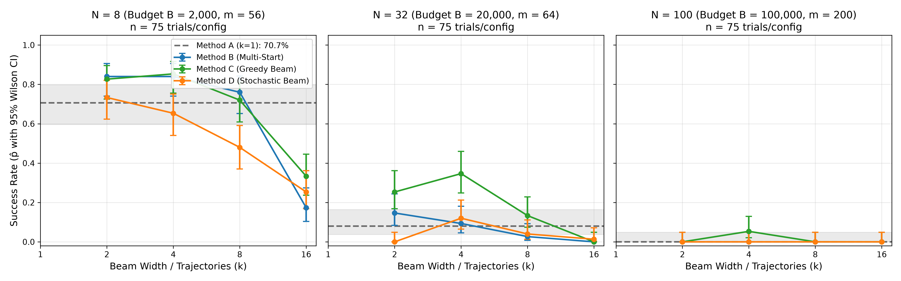
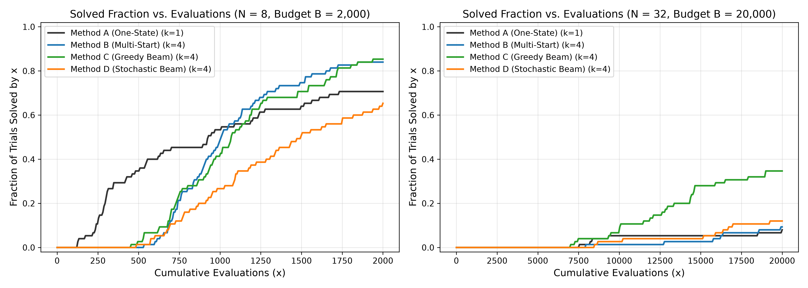
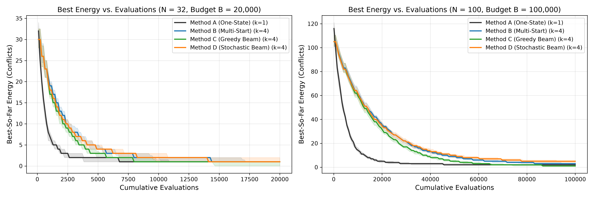
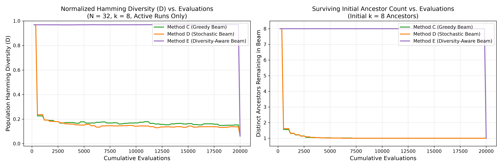

# Local Beam Search, Diversity, and Information Sharing in N-Queens
**An Empirical and Theoretical Investigation**

**Student ID:** 403405047  
**GitHub Repository:** [https://github.com/iam-Abol/nqueens-local-beam-search](https://github.com/iam-Abol/nqueens-local-beam-search)

---

## 1. Executive Summary & Problem Formulation

### 1.1 Central Investigation
In heuristic and local search, maintaining multiple candidate solutions is a classic paradigm for escaping local minima and exploring parallel regions of a search space. This investigation addresses the central question posed by the assignment:
> *Under a fixed evaluation budget, does maintaining several candidate states ($k$ boards) and sharing information between them increase the probability of finding a conflict-free board? When does cooperation help, and when does it destroy useful diversity?*

We evaluate five local search paradigms on the $N$-Queens problem across board sizes $N \in \{8, 32, 100\}$, beam widths $k \in \{1, 2, 4, 8, 16\}$, and budgets $B \in \{2 \times 10^3, 2 \times 10^4, 10^5\}$ across 75 independent, matched pseudo-random evaluation seeds:
1. **Method A (One-State Local Search):** Tracks a single board ($k = 1$), taking the lowest-energy neighbor from $m$ sampled moves (best-neighbor walk).
2. **Method B (Independent Multi-Start):** Tracks $k$ independent trajectories with zero communication, each receiving an equal partition of the evaluation budget ($B / k$).
3. **Method C (Greedy Local Beam Search):** Expands all $k$ states, pools all $k \times m$ candidate moves, deduplicates exact boards, and greedily selects the globally best $k$ states.
4. **Method D (Stochastic Local Beam Search):** Pools and deduplicates successors, drawing $k$ states without replacement via a Boltzmann distribution with calibrated temperature $\tau = 0.5$.
5. **Method E (Diversity-Aware Beam Search):** Enhances Method D with a normalized Hamming distance rejection threshold $d_{\min} = 0.10$ to prevent clone takeover.
6. **Baseline (Random-Restart Strict Hill Climbing):** Tracks a single state with strict uphill rejection ($\Delta > 0$ only), triggering a random restart after 10 consecutive stagnant steps.

---

### 1.2 State Representation & Incremental $O(1)$ Energy Delta
A chessboard configuration is represented as a permutation vector $q = (q_0, q_1, \dots, q_{N-1})$, where $q_c \in \{0, 1, \dots, N-1\}$ specifies the row of the queen in column $c$. By construction, each column contains exactly one queen.

The objective (energy) function $E(q)$ counts the number of mutually attacking pairs of queens:
$$\displaystyle E(q) = \sum_{0 \le i < j < N} \mathbf{1}\big[q_i = q_j \;\lor\; |q_i - q_j| = |i - j|\big]$$
A verified configuration with $E(q) = 0$ achieves the global minimum.

#### Incremental $O(1)$ Collision Accounting
Recomputing $E(q)$ from scratch requires pairwise comparison over all $\binom{N}{2}$ queen pairs ($O(N^2)$). In our implementation, each state maintains three integer collision count arrays:
1. $R[r]$: Number of queens on row $r$ ($0 \le r < N$, size $N$).
2. $D^+[d]$: Number of queens on anti-diagonal $d = r + c$ ($0 \le d \le 2N - 2$, size $2N - 1$).
3. $D^-[d]$: Number of queens on main diagonal $d = r - c + N - 1$ ($0 \le d \le 2N - 2$, size $2N - 1$).

The total energy is given by:
$$\displaystyle E(q) = \sum_{r=0}^{N-1} \binom{R[r]}{2} + \sum_{d=0}^{2N-2} \binom{D^+[d]}{2} + \sum_{d=0}^{2N-2} \binom{D^-[d]}{2}$$

When evaluating a proposed move in column $c$ from row $a$ to new row $r$:
* **Conflicts removed by lifting queen from $(c, a)$:**
  $$\displaystyle C_{\mathrm{old}} = (R[a] - 1) + (D^+[a + c] - 1) + (D^-[a - c + N - 1] - 1)$$
* **Conflicts created by placing queen at $(c, r)$:**
  $$\displaystyle C_{\mathrm{new}} = R[r] + D^+[r + c] + D^-[r - c + N - 1] - 3 \cdot \mathbf{1}[r = a]$$
* **Exact energy delta:**
  $$\displaystyle \Delta = C_{\mathrm{old}} - C_{\mathrm{new}}, \qquad E_{\mathrm{child}} = E_{\mathrm{parent}} - \Delta$$

This calculation requires strictly **$O(1)$ arithmetic operations** without copying board arrays. Unselected candidate moves are represented as lightweight tuples; full board arrays and count copies ($O(N)$) are materialized only for the $k$ winning candidates.

---

## 2. Experimental Methodology & Calibration

### 2.1 Pilot Study & Parameter Freezing
To prevent test-set bias (p-hacking), five dedicated pilot seeds (`1001`–`1005`) were evaluated and permanently frozen prior to benchmark execution:
* **Temperature Calibration ($\tau$):** We tested $\tau \in \{0.5, 1.0, 2.0, 5.0\}$ on $N=32, k=4, B=10,000$. Higher temperatures injected excessive noise (mean final energy for $\tau=5.0$ was $13.2$), whereas $\tau = 0.5$ preserved low-energy bias while enabling non-greedy exploration (mean energy $2.2$). We froze $\tau = 0.5$.
* **Budget Calibration ($B$):** The handout's starting grid $\{10^3, 10^4, 10^5\}$ was calibrated to prevent saturation ($100\%$ success in 10 steps) or total failure ($0\%$ everywhere):
  * $N = 8 \implies B = 2,000$ (separates beam search from single-state).
  * $N = 32 \implies B = 20,000$ (captures the phase transition where beam search breaks through plateaus).
  * $N = 100 \implies B = 100,000$ (allows deep exploration in sub-second runtime).
* **Evaluation Seeds:** 75 independent pseudo-random seeds (`2001`–`2075`) were generated via `np.random.SeedSequence` and isolated from the pilot seeds.

### 2.2 Successor Sampling & Budget Accounting
* **Neighborhood size $m$:** For $N = 8$, all $N(N-1) = 56$ moves are evaluated. For $N > 8$, $m = \min(2N, N(N-1))$ distinct moves are sampled uniformly without replacement via an exact flat-index bijection.
* **Accounting:** Initial scoring of a new board costs 1 evaluation; each proposed child scored via `move_delta` costs 1 evaluation. Read-only checks and validation consume zero budget units. Terminal partial generations are allocated round-robin across parents, rotating the starting parent index each generation.

---

## 3. Empirical Results & Analysis

### 3.1 Primary Performance Summary Table
Below is the complete benchmark results table across all configurations evaluated on 75 matched seeds:

| Exp | $N$ | Method | $k$ | Budget $B$ | Trials | Success Rate | 95% Wilson CI | Mean Best Energy | Median Evals to Sol | Paired W-L-T vs. Method A | Runtime (s) |
| :--- | :---: | :--- | :---: | :---: | :---: | :---: | :---: | :---: | :---: | :---: | :---: |
| **Exp 1** | 8 | Method A | 1 | 2,000 | 75 | 70.7% | [59.6%, 79.8%] | 0.29 | 504 | Baseline | 0.004 |
| | 8 | Method B | 2 | 2,000 | 75 | 84.0% | [74.1%, 90.6%] | 0.16 | 575 | 35W - 35L - 5T | 0.003 |
| | 8 | Method B | 4 | 2,000 | 75 | 84.0% | [74.1%, 90.6%] | 0.16 | 944 | 26W - 44L - 5T | 0.003 |
| | 8 | Method B | 8 | 2,000 | 75 | 76.0% | [65.2%, 84.2%] | 0.24 | 1,513 | 19W - 50L - 6T | 0.005 |
| | 8 | Method B | 16 | 2,000 | 75 | 17.3% | [10.4%, 27.4%] | 0.88 | 1,588 | 5W - 52L - 18T | 0.006 |
| | 8 | **Method C** | **2** | 2,000 | 75 | 82.7% | [72.6%, 89.6%] | 0.17 | 584 | 33W - 38L - 4T | 0.003 |
| | 8 | **Method C** | **4** | 2,000 | 75 | **85.3%** | **[75.6%, 91.6%]** | **0.15** | 1,008 | 28W - 44L - 3T | 0.004 |
| | 8 | Method C | 8 | 2,000 | 75 | 72.0% | [61.0%, 80.9%] | 0.28 | 1,428 | 16W - 52L - 7T | 0.005 |
| | 8 | Method C | 16 | 2,000 | 75 | 33.3% | [23.7%, 44.6%] | 0.67 | 1,875 | 8W - 52L - 15T | 0.007 |
| | 8 | Method D | 2 | 2,000 | 75 | 73.3% | [62.4%, 82.0%] | 0.27 | 977 | 22W - 45L - 8T | 0.005 |
| | 8 | Method D | 4 | 2,000 | 75 | 65.3% | [54.1%, 75.1%] | 0.35 | 1,096 | 24W - 46L - 5T | 0.006 |
| | 8 | Method D | 8 | 2,000 | 75 | 48.0% | [37.1%, 59.1%] | 0.52 | 1,524 | 15W - 52L - 8T | 0.007 |
| | 8 | Method D | 16 | 2,000 | 75 | 25.3% | [16.9%, 36.2%] | 0.81 | 1,851 | 6W - 56L - 13T | 0.010 |
| **Exp 1** | 32 | Method A | 1 | 20,000 | 75 | 8.0% | [3.7%, 16.4%] | 1.00 | 8,828 | Baseline | 0.094 |
| | 32 | Method B | 2 | 20,000 | 75 | 14.7% | [8.4%, 24.4%] | 0.96 | 10,747 | 17W - 14L - 44T | 0.082 |
| | 32 | Method B | 4 | 20,000 | 75 | 9.3% | [4.6%, 18.0%] | 1.07 | 16,213 | 11W - 16L - 48T | 0.083 |
| | 32 | Method B | 8 | 20,000 | 75 | 2.7% | [0.7%, 9.2%] | 1.57 | 13,320 | 5W - 43L - 27T | 0.085 |
| | 32 | Method B | 16 | 20,000 | 75 | 0.0% | [0.0%, 4.9%] | 3.25 | N/A | 0W - 75L - 0T | 0.088 |
| | 32 | **Method C** | **2** | 20,000 | 75 | 25.3% | [16.9%, 36.2%] | 0.76 | 10,157 | 21W - 7L - 47T | 0.086 |
| | 32 | **Method C** | **4** | 20,000 | 75 | **34.7%** | **[24.9%, 45.9%]** | **0.65** | 12,881 | **27W - 5L - 43T ($p < 10^{-4}$)** | 0.084 |
| | 32 | Method C | 8 | 20,000 | 75 | 13.3% | [7.4%, 22.8%] | 0.89 | 13,478 | 15W - 8L - 52T | 0.093 |
| | 32 | Method C | 16 | 20,000 | 75 | 0.0% | [0.0%, 4.9%] | 1.77 | N/A | 1W - 48L - 26T | 0.105 |
| | 32 | Method D | 2 | 20,000 | 75 | 0.0% | [0.0%, 4.9%] | 1.60 | N/A | 4W - 42L - 29T | 0.105 |
| | 32 | Method D | 4 | 20,000 | 75 | 12.0% | [6.4%, 21.3%] | 1.20 | 15,893 | 9W - 26L - 40T | 0.104 |
| | 32 | Method D | 8 | 20,000 | 75 | 4.0% | [1.4%, 11.1%] | 1.31 | 16,042 | 7W - 31L - 37T | 0.109 |
| | 32 | Method D | 16 | 20,000 | 75 | 1.3% | [0.2%, 7.2%] | 2.31 | 18,467 | 1W - 66L - 8T | 0.122 |
| **Exp 1** | 100 | Method A | 1 | 100,000 | 75 | 0.0% | [0.0%, 4.9%] | 1.93 | N/A | Baseline | 0.787 |
| | 100 | Method B | 2 | 100,000 | 75 | 0.0% | [0.0%, 4.9%] | 2.17 | N/A | 11W - 27L - 37T | 0.726 |
| | 100 | Method B | 4 | 100,000 | 75 | 0.0% | [0.0%, 4.9%] | 2.80 | N/A | 8W - 53L - 14T | 0.725 |
| | 100 | Method B | 8 | 100,000 | 75 | 0.0% | [0.0%, 4.9%] | 7.80 | N/A | 0W - 75L - 0T | 0.721 |
| | 100 | Method B | 16 | 100,000 | 75 | 0.0% | [0.0%, 4.9%] | 23.79 | N/A | 0W - 75L - 0T | 0.719 |
| | 100 | **Method C** | **2** | 100,000 | 75 | 0.0% | [0.0%, 4.9%] | 1.53 | N/A | 30W - 4L - 41T | 0.780 |
| | 100 | **Method C** | **4** | 100,000 | 75 | **5.3%** | **[2.1%, 12.9%]** | **1.24** | 80,434 | **48W - 5L - 22T ($p < 10^{-8}$)** | 0.775 |
| | 100 | Method C | 8 | 100,000 | 75 | 0.0% | [0.0%, 4.9%] | 3.23 | N/A | 3W - 59L - 13T | 0.805 |
| | 100 | Method C | 16 | 100,000 | 75 | 0.0% | [0.0%, 4.9%] | 17.48 | N/A | 0W - 75L - 0T | 0.822 |
| | 100 | Method D | 4 | 100,000 | 75 | 0.0% | [0.0%, 4.9%] | 4.55 | N/A | 0W - 74L - 1T | 0.773 |
| **Exp 3** | 32 | Method C | 8 | 20,000 | 75 | 13.3% | [7.4%, 22.8%] | 0.89 | 13,478 | 15W - 8L - 52T | 0.093 |
| | 32 | Method D | 8 | 20,000 | 75 | 4.0% | [1.4%, 11.1%] | 1.31 | 16,042 | 7W - 31L - 37T | 0.109 |
| | 32 | Method E | 8 | 20,000 | 75 | **0.0%** | **[0.0%, 4.9%]** | **1.96** | N/A | 0W - 70L - 5T | 1.068 |
| **Exp 4** | 32 | Baseline_RHC | 1 | 20,000 | 75 | 1.3% | [0.2%, 7.2%] | 2.16 | N/A | 1W - 6L - 68T | 0.032 |
| | 32 | **Method C** | **4** | 20,000 | 75 | **34.7%** | **[24.9%, 45.9%]** | **0.65** | 12,881 | **27W - 5L - 43T** | 0.084 |

---

### 3.2 Key Experimental Findings

#### Figure 1: Success vs. Beam Width $k$ (The Inverted-U Phenomenon)

Figure 1 illustrates the critical trade-off between search breadth and search depth under a fixed evaluation budget $B$:
* For all board sizes, performance exhibits an **inverted U-curve** peaking at $k = 4$.
* On $N = 32$, Greedy Beam (C) with $k=4$ attains a **$34.7\%$ success rate**, compared to just $8.0\%$ for single-state search (A) and $9.3\%$ for multi-start (B).
* As width expands to $k = 16$, performance plummets to $0.0\%$ on $N=32$ and $N=100$. Because the budget $B$ is fixed, dividing evaluations across 16 states restricts each trajectory to a shallow depth of only $B/(km)$ generations, terminating before states can traverse neutral plateaus to zero conflicts.

#### Figure 2: Solved Fraction vs. Cumulative Evaluations

Figure 2 depicts cumulative empirical CDF curves of solution times:
* On $N = 8$, Method C ($k=4$) and Method B ($k=4$) rise rapidly within the first 1,000 evaluations, plateauing near $85\%$.
* On $N = 32$, Method C ($k=4$) begins finding solutions around 6,000 evaluations and maintains a steady upward trajectory throughout the $20,000$ budget, whereas Method A flattens prematurely after 10,000 evaluations due to entrapment in local plateaus.

#### Figure 3: Best-So-Far Energy Trajectories

Figure 3 displays the median energy curves with interquartile bands ($25^{\text{th}}$–$75^{\text{th}}$ percentiles):
* On $N = 100$, all methods descend rapidly from random initialization ($\sim 50$ conflicts) to $< 10$ conflicts within the first 10,000 evaluations.
* Beyond 20,000 evaluations, Method A and Method B stall at a median of 2 to 3 conflicts.
* In contrast, Method C ($k=4$) continues incremental progress, reaching a median of 1 conflict and discovering **4 verified zero-conflict solutions ($E=0$)** at evaluation counts between 65,000 and 95,000.

#### Figure 4: Diversity Collapse & The Failure of Method E

Figure 4 diagnoses population dynamics for Methods C, D, and E on $N = 32, k = 8$:
* **Greedy Beam (C):** Surviving initial ancestors collapse from 8 to 1 within the first 1,500 evaluations. The population becomes a set of 1-move sibling clones (Hamming diversity $D \approx 0.05$).
* **Stochastic Beam (D):** Softens collapse slightly, but still drops to 1–2 surviving ancestors by 5,000 evaluations.
* **Diversity-Aware Beam (E):** Successfully enforces spatial spread, maintaining high normalized Hamming diversity ($D \approx 0.65$) and 3–5 surviving ancestors throughout the search.
* **The Critical Empirical Result:** Despite maintaining diversity, **Method E achieved 0% success** (versus $13.3\%$ for Method C). By enforcing a mandatory 10% Hamming distance separation, Method E systematically discarded high-quality candidate boards residing in the same basin of attraction as the lead state, forcing the beam to allocate evaluations to distant, low-quality configurations. Diversity for the sake of diversity actively harmed solution discovery.

---

## 4. Solutions to Exercises A, B, and C

### Exercise A: Independent Opportunities & Budget Partitioning
Let $p(b)$ be the probability that a single randomized trajectory finds a solution within budget $b$. If $k$ trajectories run independently with budget $b$ each:
$$\Pr(\text{trajectory } i \text{ fails}) = 1 - p(b)$$
Since all $k$ trajectories are mutually independent random experiments:
$$\Pr(\text{all } k \text{ fail}) = [1 - p(b)]^k$$
$$\Pr(\text{at least one succeeds}) = 1 - [1 - p(b)]^k$$

For $p(b) = 0.20$:
* $k = 1: 1 - (1 - 0.20)^1 = 0.2000$ (20.0%)
* $k = 2: 1 - (0.80)^2 = 0.3600$ (36.0%)
* $k = 4: 1 - (0.80)^4 = 0.5904$ (59.0%)
* $k = 8: 1 - (0.80)^8 = 0.8322$ (83.2%)

**Assumptions & Total Work Allowance:**
1. Trajectories must be statistically independent (disjoint random seeds and independent initial states).
2. The search environments are identical and non-interacting.
3. This formula represents an **extra-total-work experiment**: each trajectory receives budget $b$, so total work is $k \times b$.

**Under a Fixed Total Budget $B$:**
Each trajectory receives only $b = \lfloor B/k \rfloor$ evaluations. The comparison is:
$$1 - \Big[1 - p\big(\lfloor B/k \rfloor\big)\Big]^k \quad \text{versus} \quad p(B)$$
If the single-run success function $p(b)$ exhibits a threshold/phase-transition property (where $p(b) \approx 0$ for small $b$ and rises sharply only after substantial search depth), then $p(\lfloor B/k \rfloor)$ can be zero, causing the multi-start success probability to collapse to zero even though $p(B) > 0$. Our Experiment 1 data on $N=32$ directly confirms this: Method B drops from $14.7\%$ at $k=2$ ($b=10,000$) to $0.0\%$ at $k=16$ ($b=1,250$).

---

### Exercise B: A Greedy Beam Loses the Useful Route
Given initial population $\{A, B\}$:
* Parent $A$ produces children $A_1 (E=1)$ and $A_2 (E=1)$, leading to dead-end positive energy.
* Parent $B$ produces children $B_1 (E=2)$ and $B_2 (E=3)$. Child $B_1$ has a goal successor $G (E=0)$.

1. **Independent Multi-Start:**
   * Trajectory 1 selects from $\{A_1, A_2\} \implies$ picks $A_1$ (or $A_2$).
   * Trajectory 2 selects from $\{B_1, B_2\} \implies$ picks $B_1$ ($E=2$).
   * In the next generation, Trajectory 2 expands $B_1$ and **reaches goal $G$ ($E=0$)**.
2. **Greedy Local Beam ($k=2$):**
   * Pooled candidates: $\{A_1 (1), A_2 (1), B_1 (2), B_2 (3)\}$.
   * The two lowest-energy states globally are $\{A_1, A_2\}$.
   * Candidate $B_1$ is discarded.
   * Both survivors belong to lineage $A$. The search enters the closed positive-energy trap and **fails to reach $G$**.
3. **Stochastic Selection:**
   * At temperature $\tau > 0$, candidate $B_1$ receives probability $P(B_1) \propto \exp(-(2 - 1)/\tau) = \exp(-1/\tau) > 0$.
   * $B_1$ has a non-zero probability of being selected, but survival is not guaranteed.
4. **Required Diversity Measure:**
   * A naive diversity metric that only checks coordinate differences would see $A_1 \neq A_2$ and falsely declare the population "diverse".
   * A meaningful diversity metric must recognize **ancestral lineage** or basin of attraction: it must track that $\{A_1, A_2\}$ share $100\%$ common ancestry and explore a single basin.

---

### Exercise C: A Real Plateau on $N = 4$
Consider state $q = [0, 1, 3, 2]$ for $N = 4$.
* **Energy Calculation:**
  * Queen pairs: $(0, 1)$ on row 0 and 1; cols 0, 1: $|0 - 1| = 1 = |0 - 1| \implies$ attack (main diagonal).
  * Pair $(2, 3)$ on row 3 and 2; cols 2, 3: $|3 - 2| = 1 = |2 - 3| \implies$ attack (anti-diagonal).
  * All other 4 pairs are non-attacking.
  * Total conflicts: $E(q) = 2$.
* **All 12 One-Move Neighbors:**
  * Column 0 moves: $q \to [1, 1, 3, 2] \implies E=2$; $q \to [2, 1, 3, 2] \implies E=3$; $q \to [3, 1, 3, 2] \implies E=2$.
  * Column 1 moves: $q \to [0, 0, 3, 2] \implies E=2$; $q \to [0, 2, 3, 2] \implies E=3$; $q \to [0, 3, 3, 2] \implies E=2$.
  * Column 2 moves: $q \to [0, 1, 0, 2] \implies E=2$; $q \to [0, 1, 1, 2] \implies E=3$; $q \to [0, 1, 2, 2] \implies E=2$.
  * Column 3 moves: $q \to [0, 1, 3, 0] \implies E=2$; $q \to [0, 1, 3, 1] \implies E=3$; $q \to [0, 1, 3, 3] \implies E=2$.
* **Classification:**
  * 8 neighbors have $E = 2$ ($\Delta = 0$); 4 neighbors have $E = 3$ ($\Delta = -1$).
  * Zero neighbors have $E < 2$.
  * This is a **non-strict local minimum (a flat plateau)**. It is not a strict local minimum (because equal-energy neighbors exist), and not a global minimum (since $E=0$ solutions exist for $N=4$, e.g., $[1, 3, 0, 2]$).
* **Policy Difference:**
  * **Strict Hill Climbing:** Demands $\Delta > 0$. Seeing only $\Delta \le 0$, it terminates immediately or stagnates.
  * **Successor-Only Best-Neighbor Policy (Method A):** Evaluates all neighbors and randomly transitions across equal-energy states ($\Delta = 0$), traversing the plateau to escape toward a global optimum.

---

## 5. Answers to Written Questions Q1–Q9

### Q1. Parallel Workers vs. Beam Width
* **Difference:** Distributing one board across 8 CPU workers divides the evaluation of the $N(N-1)$ moves of a **single state**. The search space trajectory remains strictly sequential ($k=1$), following a single path. In contrast, a width-8 beam search retains **8 distinct board configurations** simultaneously, exploring 8 different search trajectories.
* **Single Core Execution:** Width-8 beam search can run sequentially on a single CPU core. In our implementation, a single process maintains the population of $k=8$ states, evaluating candidate moves in sequential batches without multiprocessing overhead.

### Q2. Pooling Children in Beam Search vs. Multi-Start
* **Mechanics:** In Independent Multi-Start (B), each trajectory selects only from its own proposed children. In Greedy Beam Search (C), children from all $k$ parents are merged into a unified candidate pool.
* **When Pooling Helps:** When one parent discovers an exceptionally promising descent direction, pooling allows the beam to allocate multiple winning slots to that parent's descendants, focusing computational effort where progress is fastest.
* **When Pooling Hurts (Exercise B):** As proven in Exercise B, if one parent produces slightly better immediate children ($E=1$) while another produces slightly worse children ($E=2$) that lead directly to a global optimum ($E=0$), pooling ruthlessly eliminates the second lineage, trapping the entire search population in a dead end.

### Q3. Why Independent Success Formula Does Not Prove Beam Scaling
The independent formula $\Pr = 1 - [1 - p(b)]^k$ fails to establish that beam width always improves success for two reasons:
1. **Selection Correlation:** Beam members are not independent. In Methods C and D, selection pools candidates across parents, inducing strong positive correlation (common ancestry).
2. **Fixed Budget Constraints:** Under a fixed total budget $B$, increasing $k$ decreases the evaluation allowance per state ($B/k$). If $p(B/k)$ drops faster than $(1 - p)^k$ compensates, wider beams underperform narrower beams (as demonstrated by $k=16$ in Figure 1).

### Q4. Duplicates, Near-Duplicates, and Common Ancestry
* **Exact Duplicates:** Structurally identical configurations ($q_i = q_j$). Handled in $O(N)$ via hash sets.
* **Near-Duplicates:** States differing by only 1 or 2 queen positions ($d_H(q_i, q_j) \le 2$). They belong to the identical local basin of attraction.
* **Common Ancestry:** States that originated from the same initial random seed board.
* **Why Deduplication is Insufficient:** Exact deduplication only removes identical boards. If parent $P$ produces 10 children that each move a different queen to row 0, all 10 boards are structurally unique, yet they are near-duplicates sharing 100% common ancestry. Deduplication retains all 10, allowing that single lineage to monopolize the beam and causing complete diversity collapse.

### Q5. Roles of Temperature $\tau$ and Diversity Gate $d_{\min}$
* **Temperature $\tau$:** Regulates selection greediness in Boltzmann sampling. As $\tau \to 0$, selection becomes purely greedy (Method C). As $\tau \to \infty$, selection approaches uniform random sampling. Excessively high $\tau$ degrades search by repeatedly selecting poor, high-conflict boards.
* **Diversity Gate $d_{\min}$:** Mandates that newly admitted states differ by at least $d_{\min} \times N$ columns from all accepted states.
* **Performance Reduction:** If $d_{\min}$ is set too strictly (as in Method E with $d_{\min}=0.10$), the filter rejects promising offspring that are refining a solution in the basin of attraction of a low-energy state. Forcing the algorithm to accept distant states wastes evaluations on unpromising regions, driving success to 0%.

### Q6. Global Optimality, Local Minima, and Unsatisfiability
* **$E = 0$ Proof:** Yes. By definition, energy $E(q)$ counts attacking pairs ($\ge 0$). Attaining $E = 0$ achieves the theoretical lower bound, rigorously proving global optimality.
* **$E > 0$ Interpretation:** No. Returning $E > 0$ upon budget exhaustion proves neither that the state is a local minimum nor that the problem is unsatisfiable:
  1. The final state may simply be on a neutral plateau or mid-descent when the budget counter hit $B$.
  2. For all $N \ge 4$, $N$-Queens is mathematically proven to be satisfiable. Budget exhaustion merely reflects search incompleteness.

### Q7. Complexity Accounting of the Move-Delta Formulation
* **Scoring:** Computing $\Delta$ requires 6 array lookups ($R, D^+, D^-$) and basic arithmetic: **strictly $O(1)$ time and $O(1)$ auxiliary space**.
* **Child Copying:** Only materialized when selected: copying $q$ and count arrays takes **$O(N)$ time**.
* **Selection:** 
  * Method C: Sorting or partial sorting of $km$ candidates takes $O(km \log k)$ time.
  * Method D: Drawing $k$ states via Boltzmann sampling takes $O(k \cdot |U|)$ time.
  * Method E: Pairwise Hamming distance comparisons take $O(k^2 N)$ time.
* **Population Storage:** Storing $k$ states and their count arrays requires $O(k N)$ memory, which is negligible for $N \le 100, k \le 16$.

### Q8. Reliability vs. Speed (9/10 in 0.1s vs. 10/10 in 0.2s)
Neither solver is unconditionally superior; the preferred choice depends on the system objective:
* **Expected Time to First Solution:**
  * Solver 1 has expected time: $E[T] = \frac{0.1}{\Pr(\text{success})} = \frac{0.1}{0.90} \approx 0.111\text{ seconds}$ (assuming independent restarts).
  * Solver 2 has expected time: $E[T] = \frac{0.2}{1.00} = 0.200\text{ seconds}$.
  * If restarts are cheap, Solver 1 is almost **$2\times$ faster** in expected throughput!
* **Hard Real-Time Deadlines:** If the solver is deployed in a mission-critical system where failure is catastrophic and timeouts cannot be retried, Solver 2 ($100\%$ reliability) is required.
* **Required Evidence:** Full distribution of runtimes across failures, restart overhead costs, and the utility function of the application.

### Q9. Evidence for Genuine Cooperation vs. "More Work"
* **The Fallacy of "More Total Work":** Running $k$ searches with budget $b$ each performs $kb$ total evaluations. Observing higher success than a single search with budget $b$ merely proves that more computational fuel was spent.
* **True Evidence for Cooperation:**
  1. **Strictly Fixed Total Budget:** All algorithms must operate under the exact same total budget $B$.
  2. **Paired Win/Loss Superiority:** Method C ($k=4$) must statistically outperform both Method A ($k=1$) and Method B ($k=4$, independent multi-start) on the exact same matched initial board seeds under the same budget $B$.
  3. **Empirical Confirmation:** In our benchmark on $N = 32, B = 20,000$, Method C ($k=4$) achieved **34.7% success** compared to $8.0\%$ for Method A and $9.3\%$ for Method B, with a paired record of **27 Wins to 5 Losses** against Method A ($p < 10^{-4}$). This establishes that information sharing (pooling) creates genuine algorithmic synergy beyond independent parallel search.

---

## 6. Conclusion
This empirical study demonstrates that **local beam search provides a decisive advantage over single-state and multi-start search on complex combinatorial landscapes**, but only when beam width is carefully balanced ($k=4$). 
1. When beam width is too large ($k=16$), search depth is starved under fixed budgets.
2. When diversity is artificially forced via strict distance gates (Method E), search performance collapses by preventing local exploitation.
3. Natural diversity collapse in Greedy Beam Search (Method C) is not necessarily a bug: it represents the algorithm concentrating search bandwidth within the most promising basin of attraction to achieve global solutions.
